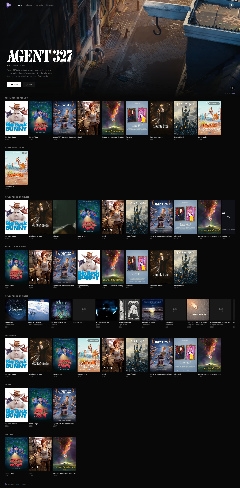
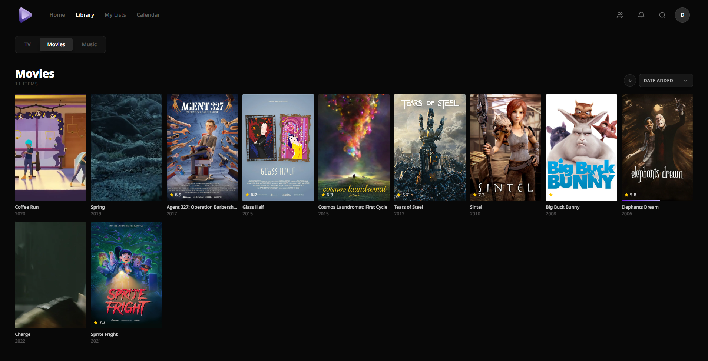
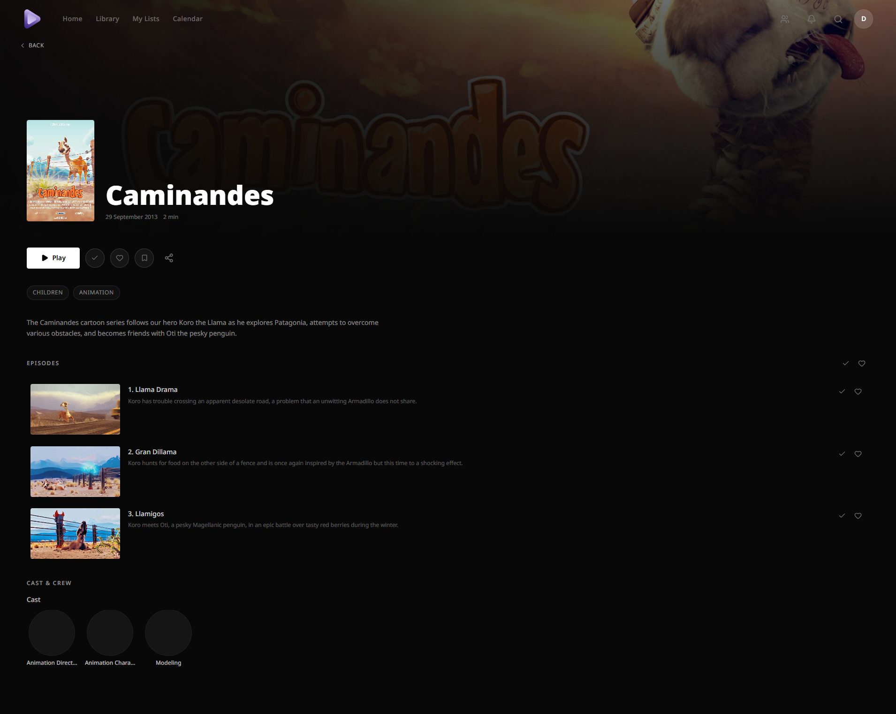
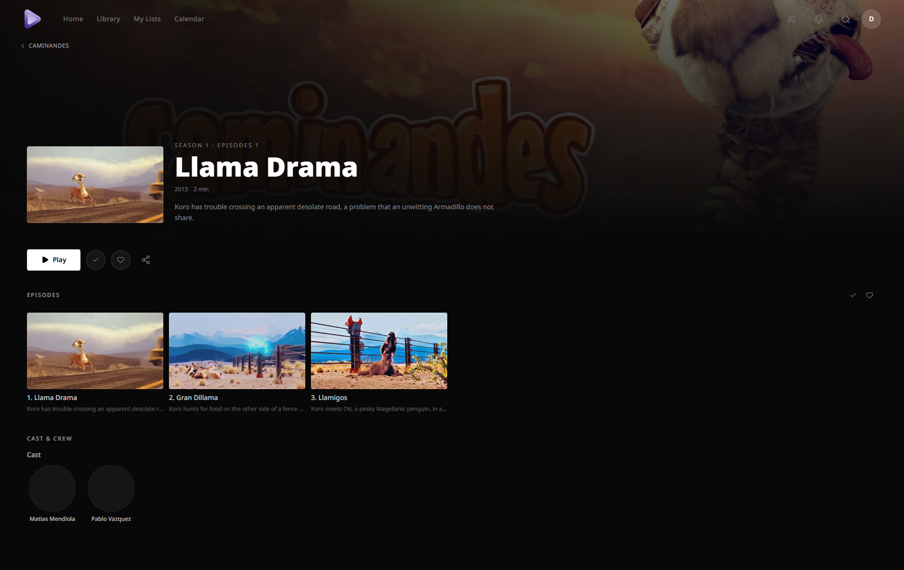
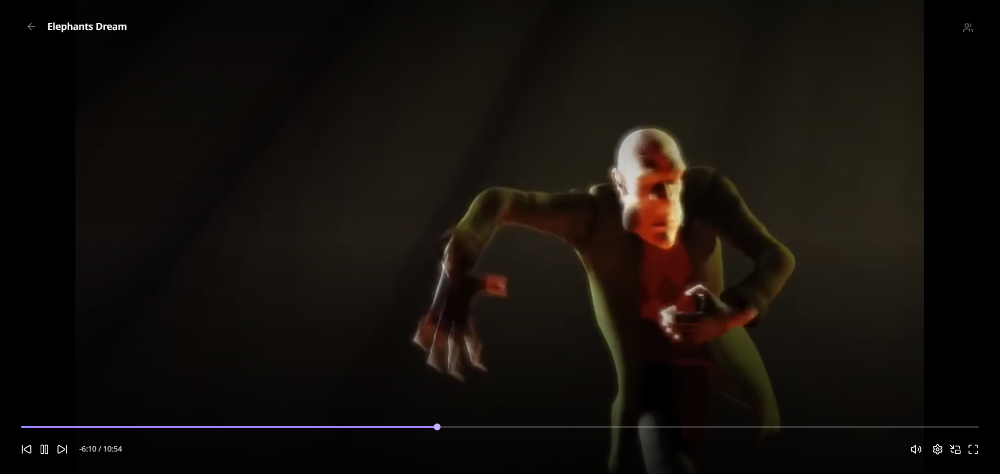
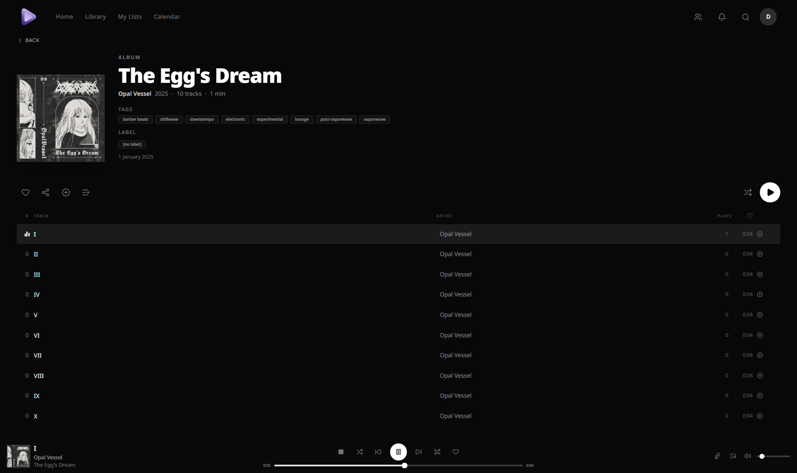

<div align="center">
  <a href="./public/icon.png">
    
  </a>
  <h3 align="center">ZenStream Web</h3>
  <p align="center">
    A web client for <a href="https://github.com/Loco-CTO/zenstream">ZenStream</a>.
    <br />
    <br />
    <a href="https://github.com/Loco-CTO/zenstream/issues">Submit Issues</a>
    ·
    <a href="https://github.com/Loco-CTO/zenstream/releases">Releases</a>
  </p>
</div>

<div align="center">

[](https://github.com/Loco-CTO/zenstream)
[](https://github.com/Loco-CTO/zenstream)
[](https://github.com/Loco-CTO/zenstream/blob/main/LICENSE)
[](https://github.com/Loco-CTO/zenstream)

</div>

## How it fits together

ZenStream has one Orchestrator backend and two clients:

- [Web client](https://github.com/Loco-CTO/zenstream)
- [Android client](https://github.com/Loco-CTO/zenstream-mobile)
- [Orchestrator](https://github.com/Loco-CTO/zenstream-orchestrator)

## Demo screenshots

<details>
<summary><strong>Home</strong></summary>

<p align="center"><a href="./screenshots/home-page.png"></a></p>

</details>

<details>
<summary><strong>Catalog</strong></summary>

<p align="center"><a href="./screenshots/catalog-view.png"></a></p>

</details>

<details>
<summary><strong>Series details</strong></summary>

<p align="center"><a href="./screenshots/series-view.png"></a></p>

</details>

<details>
<summary><strong>Episode details</strong></summary>

<p align="center"><a href="./screenshots/episode-view.png"></a></p>

</details>

<details>
<summary><strong>Video player</strong></summary>

<p align="center"><a href="./screenshots/videoplayer.png"></a></p>

</details>

<details>
<summary><strong>Album details</strong></summary>

<p align="center"><a href="./screenshots/album-view.png"></a></p>

</details>

## Configuration

For local development, copy `.env.example` to `.env.local` and set `ZENSTREAM_ORCHESTRATOR_URL` to the Orchestrator address reachable from your browser.

- `ZENSTREAM_ORCHESTRATOR_URL`: Runtime URL of the Orchestrator. It may include a path prefix and is read when the web server starts.
- `ZENSTREAM_PORT`: Docker host port. It defaults to `9086`.
- `ZENSTREAM_IMAGE`: Docker image to run. It defaults to `ghcr.io/loco-cto/zenstream:latest`.

The container exposes the runtime Orchestrator URL to the browser before the app initializes and applies a Content Security Policy restricted to that configured origin. Artwork capability URLs remain direct requests to the Orchestrator.

## Development

Start the Orchestrator first. Requires Node.js and pnpm.

```sh
pnpm install
pnpm dev
```

## Deployment

For Docker Compose deployment, copy `.env.example` to `.env`, set `ZENSTREAM_ORCHESTRATOR_URL`, and start the published image:

```sh
docker compose pull
docker compose up -d
```

The web client is available at `http://localhost:9086` by default. Stop it with `docker compose down`.

To pin a version, set `ZENSTREAM_IMAGE=ghcr.io/loco-cto/zenstream:vX.Y.Z`. Images are also published by full candidate SHA as `ghcr.io/loco-cto/zenstream:sha-<full-commit-sha>`.

The Compose file keeps its local source build. Run `docker compose up -d --build` to build the checked-out source instead of pulling the configured image. Changing the Orchestrator URL does not require rebuilding.

## Checks

```sh
pnpm format:check
pnpm lint
pnpm test
pnpm build
```

## Troubleshooting

- If the web client cannot reach the Orchestrator, check that `ZENSTREAM_ORCHESTRATOR_URL` is reachable from the browser and allowed by the Orchestrator's CORS configuration. Restart the container after changing the URL; no image rebuild is needed.
- For browser or CORS errors, configure the Orchestrator's `ZENSTREAM_PUBLIC_WEB_URL` or `CORS_ORIGINS` for the web origin.

## Releases

Tagged web releases are available on [GitHub Releases](https://github.com/Loco-CTO/zenstream/releases).

## License

AGPL-3.0-or-later. See [LICENSE](LICENSE).
